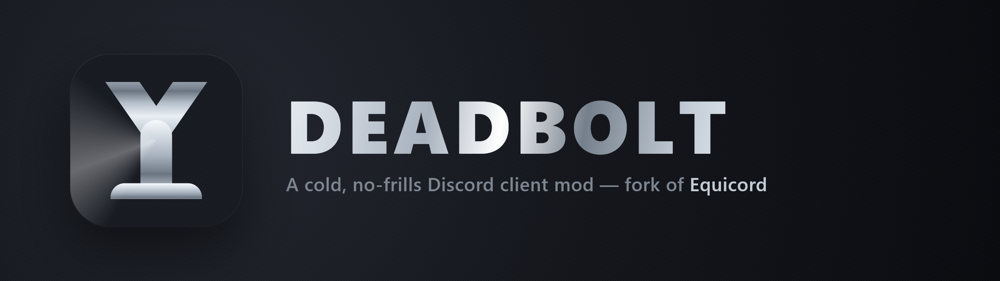

<div align="center">



[](https://github.com/kelcum/Deadbolt/actions/workflows/test.yml)
[](LICENSE)
[](#installing)
[](https://equicord.org/plugins)

**The Discord mod that survives Discord updates.**

Discord's updater quietly wipes client mods. Deadbolt notices, puts itself back, and tells you when it did. Install it once and forget about it.

Built on [Equicord](https://github.com/Equicord/Equicord) (itself a fork of [Vencord](https://github.com/Vendicated/Vencord)), with extra quality-of-life plugins on top.

**[Website](https://xan.gripe/deadbolt/) · [Windows](#windows) · [macOS](#macos) · [Linux](#linux)**

</div>

## Highlights

What sets this fork apart from vanilla Equicord:

- **Survives Discord updates** — Discord's updater resets client mods, the icon, splash and shortcuts. Deadbolt puts it all back on its own: on Windows the [one-click installer](#windows) checks every time you sign in, and [`scripts/reapply-branding.ps1`](scripts/reapply-branding.ps1) does it on demand.
- **DeadboltDoctor** — `/deadbolt` (or the toolbox, or the plugin's settings) shows whether every installed Discord version still has Deadbolt, whether the build and background tasks are healthy, and fixes it in one click: re-inject, repair everything, update now. If Discord installs an update without Deadbolt in it, a banner offers to fix it before your next restart.
- **Backup and restore** — DeadboltDoctor saves your settings, QuickCSS and your own plugins to one file and restores them later. Before restoring it shows exactly what will change, and if your plugins from the backup don't build, nothing is touched.
- **Crash safe mode** — if Discord fails to start twice in a row, Deadbolt starts with only its core plugins, tells you which plugin it suspects, and lets you go back to normal in one click.
- **Breakage alerts, opt-in** — turn on Breakage alerts in DeadboltDoctor and, when a Discord update breaks plugins, Deadbolt reports which ones so a fix can start right away. Only plugin names and Discord's build number are sent, and your own plugins are never included. Off by default.
- **A boot splash that's actually Deadbolt's** — replaces Discord's own connecting screen with an animated chrome crest and Deadbolt-branded quotes, instead of just retexting Discord's default one.
- **Animated profile badges** — a continuously rotating chrome shine on the Creator badge and a violet counterpart for Contributors, each with a rich hover card instead of a plain tooltip.
- **Design your own badge** — the badge designer in Deadbolt's settings (or [on the web](https://xan.gripe/deadbolt/badge/)) has a live preview, takes images and animated GIFs up to 5 MB, and can design a matching pair of badges in one request. Approved badges show up for everyone within about five minutes, no update needed.
- **`/addplugin` and `/myplugins`** — add, edit, switch, share and remove your own plugins from inside Discord itself. Deadbolt saves the code, rebuilds, and offers to reload. No editor, no terminal. See [Adding your own plugins](#adding-your-own-plugins).
- **QuickFind** — press Ctrl+Shift+F in any chat, DMs included, to search every message Discord has loaded there instantly and offline, step through matches with Enter, and load older history when you need it.
- **What's new, once** — after an update Deadbolt shows a short list of what changed, one time. Turn it off with the WhatsNew plugin or reopen it with `/whatsnew`.
- **VSCodeActivity** — shows the real file/workspace you're editing in VS Code instead of Discord's generic "Playing Visual Studio Code", with an optional spoof mode that fakes a coding session (and can hide real game activity) on demand.
- **A real macOS install, not a broken one** — macOS injects through Discord's external `discord_desktop_core` module instead of modifying the signed `app.asar`, so Discord's Apple code signature stays intact. See [macOS](#macos).
- **A default look out of the box** — new installs start with a black, grayscale QuickCSS theme that also tidies away Nitro/gift, stickers, emoji, Discover and a few other buttons. See [Default look](#default-look).

### Included Plugins

Deadbolt ships with the same 300+ plugin library Equicord maintains, plus whatever gets added here going forward. Browse Equicord's plugin list [here](https://equicord.org/plugins) for what's included by default.

New Deadbolt plugins:

- **BackForward** — go back and forward through the channels you visited with your mouse side buttons or Alt+Left and Alt+Right.
- **ReplyWithQuote** — select part of a message and press Q, or right click it, to reply quoting just that part.
- **ImageAutoCompress** — shrinks images that are over your upload limit so they still send instead of failing.
- **EnterToNewline** — Enter starts a new line and Ctrl+Enter sends, switchable for DMs, group chats, servers, threads and message edits.
- **NotificationHistory** — a bell in the top bar that lists your DMs, mentions and other notifications, even on Do Not Disturb, so you can catch up on what you missed and jump straight to any of them.
- **QuietHours** — silences message notifications and their sounds on a daily schedule, while people you pick (right click them, or all friends) still get through.
- **ScamLinkGuard** — warns under a message when a link imitates Discord, Steam or another big site, offers fake Nitro, hides behind misleading link text or uses lookalike letters.
- **SharedMedia** — a Shared Media button next to pins (or right-click a channel or DM) opens every image, video, file and link shared there, with Discord's viewer for flipping through them with the arrow keys.
- **ReplyChainView** — hover a reply and pick View Reply Chain to read the whole conversation it belongs to, from the first message down to its replies, in one window.
- **DraftHistory** — keeps earlier versions of each chat's draft, so text lost to a stray clear or select all and delete comes back from a button in the chat bar.

## Installing

Equicord's official installer (Equilotl) only targets the upstream Equicord repo, not this fork, so each platform has its own one-command install. Windows gets a ready-made build; macOS and Linux build Deadbolt from source and inject it.

### Windows

Paste this into PowerShell (a normal window, not "Run as administrator"):

```powershell
irm https://github.com/kelcum/Deadbolt/releases/latest/download/install.ps1 | iex
```

Or download [DeadboltSetup.exe](https://github.com/kelcum/Deadbolt/releases/latest/download/DeadboltSetup.exe) and double-click it. It isn't signed, so your browser and SmartScreen warn about it the first time (**More info → Run anyway**); the command above doesn't trigger that.

Setup finds Discord, Discord PTB and Discord Canary (if you have more than one it asks which, or does all of them), downloads the latest Deadbolt build, puts it on and starts Discord. You don't need Git, Node.js or pnpm. It also:

- **Keeps Deadbolt on after Discord updates.** Setup keeps a copy of itself in `%LOCALAPPDATA%\DeadboltInstall` and runs it quietly each time you sign in to Windows. If Discord updated without Deadbolt, it puts Deadbolt back on and restarts Discord, but only if Discord was running without it. It also puts the Deadbolt icon and splash logo back if an update reset them. This needs no internet, and you only hear from it when it can't fix something; what it did is in `repair.log` in that folder.
- **Adds Repair Deadbolt and Uninstall Deadbolt to the Start menu.** Repair downloads the latest build and puts Deadbolt back on every Discord it was on. Uninstall puts every Discord back to stock, icons included, and removes everything except your settings in `%APPDATA%\Deadbolt`. Uninstall is also listed in **Settings → Apps**.

The same from a terminal: `DeadboltSetup.exe --repair`, `DeadboltSetup.exe --uninstall`, and `--quiet` for no prompts or windows (`--repair --quiet` is the offline sign-in check).

Prefer building from source? Follow [Building from source](#building-from-source) and run `pnpm inject`; [Windows: reapplying branding after a Discord update](#windows-reapplying-branding-after-a-discord-update) covers keeping a source install patched.

### macOS

```bash
curl -fsSL https://xan.gripe/deadbolt/install-macos.sh | bash
```

Injects through Discord's external `discord_desktop_core` module rather than modifying the signed `app.asar`, so `/Applications/Discord.app` is never touched and its Apple code signature stays valid — no "Discord is damaged", no re-signing, no Gatekeeper fights. Full details, manual install, update/uninstall/repair commands: **[MACOS.md](MACOS.md)**.

### Linux

```bash
curl -fsSL https://xan.gripe/deadbolt/install-linux.sh | bash
```

Works the same way across every distro — the script just checks Git/Node.js 22+/pnpm are present and tells you the right command for your distro if one's missing (it never runs a package manager for you). Per-distro prerequisite commands, manual install, update/uninstall/repair: **[LINUX.md](LINUX.md)**.

> [!IMPORTANT]
> Make sure you aren't using an admin/root terminal for any of the above. It **will** mess up your Discord/Deadbolt instance and you **will** most likely have to reinstall.

## Building from source

<details>
<summary>Manual build, any platform</summary>

### Dependencies

[Git](https://git-scm.com/download) and [Node.js 22+](https://nodejs.org) are required.

Install `pnpm`:

```shell
npm i -g pnpm
```

Clone Deadbolt:

```shell
git clone https://github.com/kelcum/Deadbolt
cd Deadbolt
```

Install dependencies:

```shell
pnpm install --frozen-lockfile
```

Build Deadbolt:

```shell
pnpm build
```

Inject Deadbolt into your desktop client:

```shell
pnpm inject
```

Build Deadbolt for web:

```shell
pnpm buildWeb
```

After building Deadbolt's web extension, locate the appropriate ZIP file in the `dist` directory and follow your browser's guide for installing custom extensions, if supported.

Note: Firefox extension zip requires Firefox for developers

</details>

## Default look

A fresh Deadbolt install starts with a default [QuickCSS](src/main/defaultQuickCss.css): an all-black, grayscale theme (built on the T1 theme, which it loads from `eight-p.github.io`) that also hides the Nitro and gift buttons, stickers, the emoji button, apps/activities, Discover, the soundboard, noise-suppression buttons, back/forward, and the inbox and help buttons.

It's only written when you have no QuickCSS yet, so it never replaces one you already have — including on updates. To change it, open the Themes tab in Deadbolt's settings and edit QuickCSS, or switch QuickCSS off there to go back to stock Discord. The file itself lives at:

- Windows: `%APPDATA%\Deadbolt\settings\quickCss.css`
- macOS: `~/Library/Application Support/Deadbolt/settings/quickCss.css`
- Linux: `~/.config/Deadbolt/settings/quickCss.css`

## Adding your own plugins

Every build (`pnpm build` or `pnpm dev`) creates `src/userplugins` for you. Any plugin folder you put in there gets built into Deadbolt automatically.

You can also add a plugin without leaving Discord. Turn on **UserPluginUploader**, then run:

```
/addplugin name:MyPlugin file:<your plugin file>
```

- `name` becomes the folder name, so the plugin lands in `src/userplugins/MyPlugin/`. Letters, numbers, dashes and underscores only.
- `file` is the plugin code. You can drag it straight into the command. `.ts`, `.tsx`, `.js`, `.jsx` and plain `.txt` all work: it's saved as `index.tsx` if the code has JSX in it and `index.ts` otherwise.
- `replace:True` overwrites a plugin folder that already has that name.

Deadbolt then rebuilds itself, turns the plugin on and offers to reload Discord. If the rebuild fails, nothing is changed and the build error is shown in chat, so a broken file can't break your next build. The file is read locally and never sent to Discord.

### Managing them

`/myplugins` (or **Open your plugins** in UserPluginUploader's settings) lists everything in `src/userplugins`:

- **Switch** turns a plugin on or off. Most switch right away; ones that patch Discord ask you to reload.
- **Edit** opens the plugin's `index.ts`/`index.tsx` in a code editor. Tab indents and Ctrl+S saves. Saving rebuilds Deadbolt, and if the build fails the build error is shown and the file goes back to how it was.
- **Share** puts the plugin's files into the current chat's message box, so you can send them to a friend. Nothing is sent until you press Enter.
- **Remove** moves the plugin folder to `removed-userplugins/` in your Deadbolt folder (so you can bring it back) and rebuilds without it.
- **Add from file** does the same as `/addplugin`, naming the folder after the plugin.

`/toggleplugin name:<plugin>` and `/shareplugin name:<plugin>` do the same for one plugin without opening the list.

This only works when you built Deadbolt from source on the same PC (it needs the `src` folder and `pnpm` in your PATH), and only in the desktop app. The plugin file needs the usual `export default definePlugin({ name: "...", ... })` with `name` as the first property.

## Windows: reapplying branding after a Discord update

Discord's own updater (Canary or Stable) prunes old install folders and
resets a few OS-level files (its icon, the boot splash image, Start Menu
shortcuts) on every update — none of that is part of Deadbolt itself, so it
silently reverts. It can also occasionally leave the injection stub in a
broken state, which shows up as a "Cannot find module ...patcher.js" crash
on launch.

If that happens, rebuild and reapply:

```shell
pnpm install
pnpm build
powershell -ExecutionPolicy Bypass -File scripts\reapply-branding.ps1 -Restart
```

By default this reapplies to both Canary and Stable; pass `-Clients Canary` or `-Clients Stable` to restrict it to one. `-Restart` only relaunches whichever client(s) were already running — it never launches one that wasn't. When a Discord update ships a fresh `resources/app.asar`, the script moves it to `_app.asar` and puts the small Deadbolt loader folder in its place, the same way the installer does. Folders Discord is still downloading (`.app-*.installing`) are left alone, and a client is never restarted while one exists. The script exits with code 2 if the version Discord launches still doesn't have Deadbolt afterwards.

### Running this automatically

[`scripts/auto-update.ps1`](scripts/auto-update.ps1) combines all of the above into one unattended script, run only if the working tree is clean (never rebasing/force-pulling over local changes):

1. Fast-forwards from `origin/main` (your own fork) if it's ahead.
2. Merges in new commits from `upstream` Equicord/Equicord:main. A clean merge gets rebuilt and verified before being pushed back to `origin/main`; a conflicted merge is aborted and left alone for a human to resolve — it never guesses at a resolution or pushes a broken build.
3. Reapplies branding to both Canary and Stable every run regardless of 1/2 — Discord's own updater can reset that independently of any Deadbolt-side change. Only restarts a client if it was already running; never launches Discord on its own.

Logs to `scripts/auto-update.log`, moved to `auto-update.log.1` once it passes 512 KB.

- A failed build never leaves Discord on a broken build: the last good `dist\desktop` is put back and nothing is restarted. The next run retries the build until `dist\built-from.txt` matches `HEAD`.
- If a run is killed between merging upstream and pushing, the next run finds that clean merge, builds it and pushes it (or drops it and merges again if `origin/main` moved meanwhile). A merge you resolved by hand is never touched.
- Two runs never overlap; a second one exits straight away.
- Create an empty `scripts\sync.paused` file to stop pulling, merging and building while you work. Branding is still reapplied. Delete the file to resume.

It only interrupts you when something is actually wrong, with a Windows notification, or a popup if notifications are switched off for your account. Either one offers to open the log.

- **Broken** (a failed build, a merge that broke the build, a failed reapply): announced right away, then at most once every 24 hours while it lasts.
- **Only waiting** (an upstream conflict, uncommitted changes, unpushed commits, a failed push or fetch): logged quietly, and announced only if it is still like that after 3 days.

Each problem is tracked on its own in `%LOCALAPPDATA%\DeadboltAutoUpdate\last-alert.json` and forgotten as soon as a run finds it fixed. The notification code is in [`scripts/stuck-alert.ps1`](scripts/stuck-alert.ps1).

To run it automatically, register the background tasks once:

```powershell
powershell -ExecutionPolicy Bypass -File scripts\install-background-tasks.ps1
```

That adds **Deadbolt Auto-Update** (every 5 hours) and **Deadbolt Guard** (at logon and every 10 minutes, reapplying Deadbolt right after Discord updates itself). Both run hidden and only write to `scripts\guard.log` when they fix something. If an install ever looks broken, `powershell -ExecutionPolicy Bypass -File scripts\repair.ps1` rebuilds if needed, reapplies, re-registers the tasks and restarts Discord.

## Credits

Deadbolt is built on [Equicord](https://github.com/Equicord/Equicord) and its 300+ plugin library — thank you to Equicord's contributors, to [Vendicated](https://github.com/Vendicated) for creating [Vencord](https://github.com/Vendicated/Vencord), and to [Suncord](https://github.com/verticalsync/Suncord) by [verticalsync](https://github.com/verticalsync).

## Disclaimer

Discord is trademark of Discord Inc., and solely mentioned for the sake of descriptivity.
Mentioning it does not imply any affiliation with or endorsement by Discord Inc.
Deadbolt is not connected to Vencord or Equicord.

<details>
<summary>Using Deadbolt violates Discord's terms of service</summary>

Client modifications are against Discord's Terms of Service.

However, Discord is pretty indifferent about them and there are no known cases of users getting banned for using client mods! So you should generally be fine if you don't use plugins that implement abusive behaviour. But no worries, all inbuilt plugins are safe to use!

Regardless, if your account is essential to you and getting disabled would be a disaster for you, you should probably not use any client mods (not exclusive to Deadbolt), just to be safe.

Additionally, make sure not to post screenshots with Deadbolt in a server where you might get banned for it.

</details>
